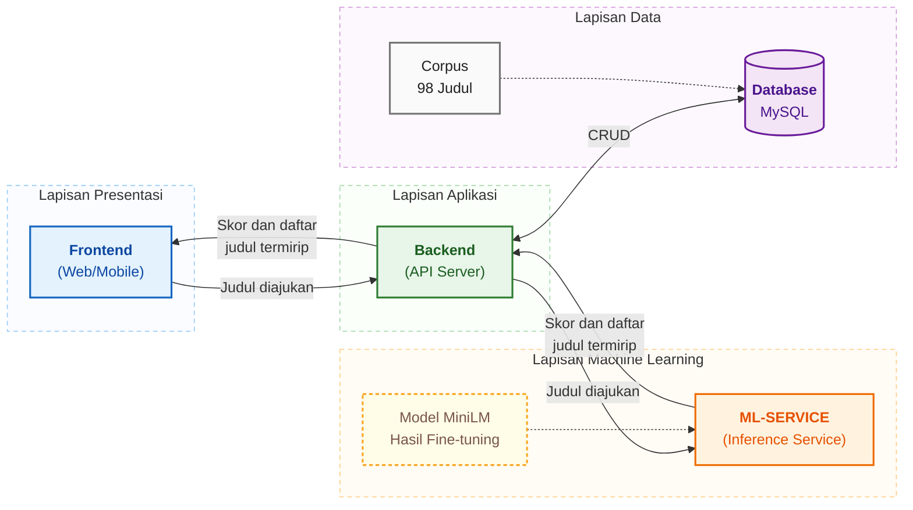

# Sistem Bimbingan Skripsi Online

Aplikasi web untuk membantu mahasiswa, dosen pembimbing, dan administrator mengelola proses bimbingan skripsi. Sistem ini mencakup pengajuan judul, pengelolaan dokumen dan revisi, komunikasi bimbingan, pemantauan progres, serta pemeriksaan kemiripan judul berdasarkan makna.

> **Proyek personal** yang dirancang dan dikembangkan secara mandiri.

## Fitur

- **Pengajuan dan pemeriksaan judul** — membandingkan judul baru dengan judul yang tersimpan berdasarkan kemiripan semantik.
- **Alur bimbingan** — mengelola bimbingan mahasiswa dan dosen, termasuk progres dan tindak lanjut.
- **Dokumen skripsi** — mendukung pengumpulan, peninjauan, dan pengelolaan dokumen.
- **Komunikasi real-time** — menyediakan chat untuk komunikasi bimbingan.
- **Notifikasi dan pengingat** — menyampaikan pembaruan serta pengingat terkait proses bimbingan.
- **Dashboard berbasis peran** — menyediakan tampilan dan akses sesuai peran mahasiswa, dosen, dan administrator.

## Pemeriksaan kemiripan judul

Layanan machine learning membuat representasi semantik dari judul yang diajukan dan judul kandidat, lalu mengurutkan kandidat berdasarkan skor kemiripan. Pendekatan ini membantu menemukan judul dengan makna yang berdekatan meskipun susunan katanya berbeda. Saat inferensi, ML service memuat model MiniLM hasil fine-tuning.

- Model dasar fine-tuning: [`sentence-transformers/paraphrase-multilingual-MiniLM-L12-v2`](https://huggingface.co/sentence-transformers/paraphrase-multilingual-MiniLM-L12-v2)
- Model hasil fine-tuning dimuat oleh ML service melalui konfigurasi `MODEL_PATH`.
- Layanan model: Python, FastAPI, dan Sentence Transformers
- API pengecekan: `POST /api/v1/pengajuan/cek-kemiripan`
- Akses endpoint membutuhkan sesi pengguna yang sudah masuk.

Hasil kemiripan merupakan alat bantu peninjauan judul, bukan keputusan otomatis mengenai kelayakan atau plagiarisme.

## Teknologi

| Bagian | Teknologi |
| --- | --- |
| Frontend | React, Vite, Tailwind CSS |
| Backend dan API | Node.js, Express, Sequelize |
| Database | MySQL |
| Layanan kemiripan | Python, FastAPI, Sentence Transformers |
| Komunikasi real-time | Socket.IO |

## Arsitektur

Frontend mengirim judul yang diajukan ke backend API. Backend membaca korpus 98 judul dari database, mengirim judul dan kandidat ke ML service, lalu meneruskan skor serta daftar judul termirip kembali ke frontend. Backend juga mengelola data di database melalui operasi CRUD. ML service menjalankan inferensi menggunakan model MiniLM hasil fine-tuning.



**Keterangan alur data**

| No. | Alur | Deskripsi |
| --- | --- | --- |
| 1 | Frontend → Backend | Pengguna mengirim judul yang diajukan melalui antarmuka web atau mobile. |
| 2 | Backend → ML-Service | Backend meneruskan judul diajukan bersama kandidat dari korpus 98 judul. |
| 3 | ML-Service → Backend | ML service menghitung skor kemiripan dan mengembalikan daftar judul termirip. |
| 4 | Backend → Frontend | Backend meneruskan skor dan daftar judul termirip untuk ditampilkan kepada pengguna. |
| 5 | Backend ↔ Database | Backend membaca korpus dan mengelola data aplikasi melalui operasi CRUD. |
| 6 | Model → ML-Service | Model MiniLM hasil fine-tuning dimuat oleh ML service saat inferensi (garis putus-putus). |

## Struktur repositori

```text
.
├── backend/       # API Express, model data, autentikasi, dan layanan aplikasi
├── frontend/      # Antarmuka React
└── ml-service/    # API Python untuk analisis kemiripan judul
```

## Menjalankan secara lokal

Jalankan ketiga layanan di terminal terpisah. Sebelum memulai, siapkan Node.js, Python, dan database MySQL.

### 1. Layanan machine learning

```bash
cd ml-service
python -m venv .venv
```

Aktifkan virtual environment sesuai terminal yang digunakan:

```bash
# Windows PowerShell
.venv\Scripts\Activate.ps1

# macOS / Linux
source .venv/bin/activate
```

Pasang dependensi dan atur `MODEL_PATH` di file `.env`

`MODEL_PATH` wajib menunjuk ke model hasil fine-tuning yang dapat dimuat Sentence Transformers. Model dasarnya perlu disesuaikan dengan file konfigurasi yang tersedia di lingkungan Anda.

```bash
pip install -r requirements.txt
uvicorn app:app --reload --host 0.0.0.0 --port 8001
```

### 2. Backend

```bash
cd backend
npm install
```

Buat `backend/.env` dan isi dengan konfigurasi lokal Anda.

Jalankan API dari direktori `backend`:

```bash
node index.js
```

Sesuaikan `PORT_APP`, konfigurasi database, dan `APP_ORIGIN` jika lingkungan lokal Anda menggunakan nilai berbeda.

### 3. Frontend

```bash
cd frontend
npm install
```

Buat `frontend/.env` dan arahkan nilainya ke alamat backend lokal Anda

Jika backend berjalan pada port selain `5000`, perbarui ketiga URL tersebut. Kemudian jalankan aplikasi:

```bash
npm run dev
```

Buka alamat lokal yang ditampilkan oleh Vite.

## Catatan keamanan dan data

- Endpoint pemeriksaan kemiripan memerlukan sesi login dan membandingkan judul dengan data kandidat yang tersimpan di aplikasi.
- Jangan membuka endpoint tersebut untuk akses publik tanpa meninjau kembali autentikasi dan data yang dikembalikan.
- Simpan rahasia, konfigurasi lokal, dan data mahasiswa di luar kontrol versi.

## Pengembangan frontend

```bash
cd frontend
npm run lint
npm run build
```
